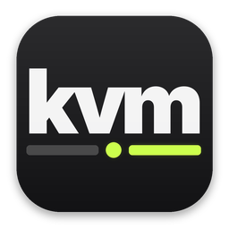

<p align="center"></p>

<h1 align="center">Kvm</h1>

<p align="center"><b>One keyboard and mouse for your Mac and your PC.</b><br>
Push the pointer off the edge of one screen and it carries on onto the other computer, keyboard and all.<br>
Copy on one, paste on the other. Send files across. No account, no cloud.</p>

<p align="center"><a href="https://kvm.pxlvzn.in">kvm.pxlvzn.in</a> · part of <a href="https://pxlvzn.in">PXL</a></p>

---

## What it does

- **One mouse and keyboard.** Arrange your computers in Kvm the way they sit on your desk, then push the pointer past
  that edge. Every pointing device crosses the same way (trackpad, any mouse), and the keyboard always goes with
  the pointer.
- **Admin prompts and the sign-in screen (Windows).** The setup installs the Kvm service, so your Mac's keyboard
  and mouse also work on UAC prompts, the lock screen and the sign-in screen after a restart. Ctrl+Alt+Del works too.
- **Shortcuts feel native.** ⌘C on the Mac is Ctrl+C on the PC (switchable). Media and volume keys carry over.
- **Shared clipboard:** text and pictures, both ways.
- **Send files and folders** both ways: drop them on a computer in the Kvm window, or use Send files.
- **Ring, lock or sleep** the other computer.
- **Cursor lock** (F14 on a Mac keyboard, Scroll Lock on a PC) keeps the pointer where it is, **hold a key to cross**
  makes edges cross only while a key is held, and <kbd>Ctrl</kbd>+<kbd>Alt</kbd>+<kbd>Esc</kbd> brings the pointer
  home from anywhere.
- **Updates itself** from GitHub Releases, like every PXL app.

## Install

| | |
|---|---|
| **macOS 11+** | `Kvm.dmg`, drag to Applications. On first open allow **Accessibility** and **Input Monitoring** for Kvm in System Settings › Privacy & Security. |
| **Windows 10/11** | `Kvm-Setup.exe`. It asks for admin once, to install the Kvm service. |

Downloads: [latest release](https://github.com/YuvrajxGarg/kvm/releases/latest) or [kvm.pxlvzn.in](https://kvm.pxlvzn.in).
The apps aren't code-signed: on a Mac right-click › Open the first time; on Windows choose *More info › Run anyway*.

## Pair two computers

1. Open Kvm on both, on the same network.
2. On one, click **Pair** next to the other computer. The other one shows a 6-digit code: type it in.
3. Drag the other computer to the side of this one where it really is. Done: push the pointer over that edge.

If a computer doesn't appear (some networks block discovery), use **Add by address** with the address shown in its
Kvm settings.

## How it works

- **Pairing** uses SPAKE2 over the 6-digit code: someone on your Wi-Fi can't learn the code or test guesses offline.
- **Every connection** derives fresh keys from the pair key and is sealed with ChaCha20-Poly1305 with counter nonces
  (no replay, no reordering). Kvm talks only to computers you've paired, directly, on port 47610.
- **macOS:** one Quartz event tap captures the mouse, trackpad and keyboard together. While the pointer is on the
  other computer the local pointer is frozen and hidden, and a watchdog re-arms the tap if macOS ever pauses it, so
  keys can't leak back to the Mac.
- **Windows:** the Kvm service (LocalSystem) runs the networking and starts a helper in the signed-in session as
  SYSTEM. The helper injects input with `SendInput` and follows Windows to whichever desktop has input (the normal
  desktop, a UAC prompt, the lock or sign-in screen). Pair keys live in `%ProgramData%\PXLVZN\Kvm`, readable only by
  the system and administrators. Installed from the zip (for example through PXL), Kvm runs without the service and
  works on the normal desktop only.

```
kvm/agent.py        pairing, links, the one-pointer state machine, clipboard, files, actions
kvm/link.py         framing and sealed frames      kvm/crypto.py   SPAKE2 + session keys
kvm/screens.py      edges, entry points, moves     kvm/keys.py     HID usage <-> Mac / Windows key codes
kvm/platform/       mac.py (Quartz), win.py (hooks + SendInput), base.py (shared logic, fake for tests)
kvm/winservice.py   the Windows service and its helper           kvm/control.py  window <-> service
kvm/ui/             the window (open index.html?demo in a browser for a preview)
```

Develop: `pip install -r requirements.txt`, `python Kvm.py` (window), `python Kvm.py run` (no window),
`python -m unittest discover tests`.

## Roadmap

Kvm is growing towards everything [TwinDesk](https://github.com/InukaAsith/TwinDesk) does, in phases:

1. **Now:** keyboard and mouse across Mac and Windows (including admin prompts and the sign-in screen), clipboard
   with pictures, files, ring, lock and sleep.
2. Screens and sound: see and control the other screen, extended display, sound and microphone, camera.
3. Android: a phone as a full peer (calls, texts, notifications, photos, its screen).
4. iPhone through the browser, AirPlay receiver on Windows, continue-where-you-left-off, many devices at once, Linux.

Kvm is its own code. It was inspired by TwinDesk (GPL-3.0) and shares no code with it.

## License

MIT
